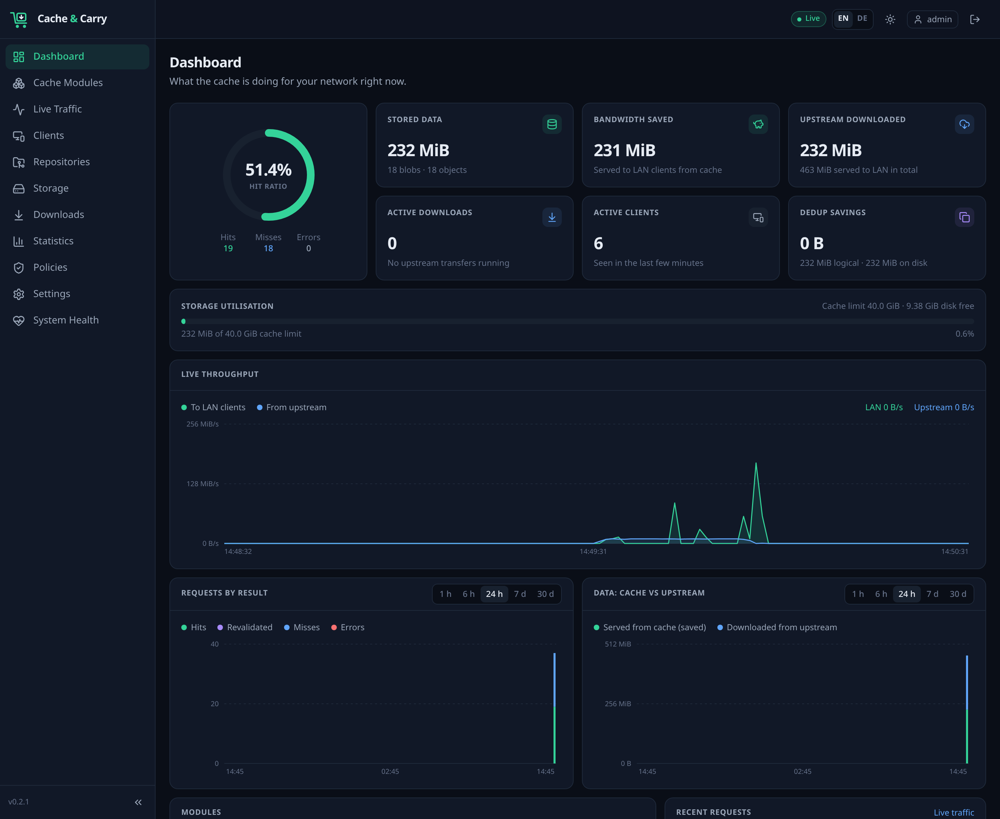
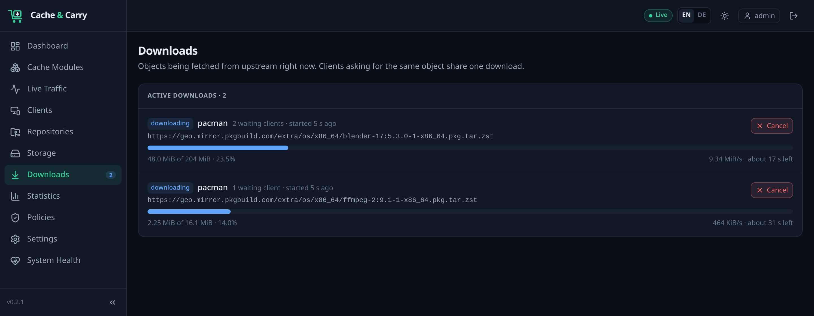
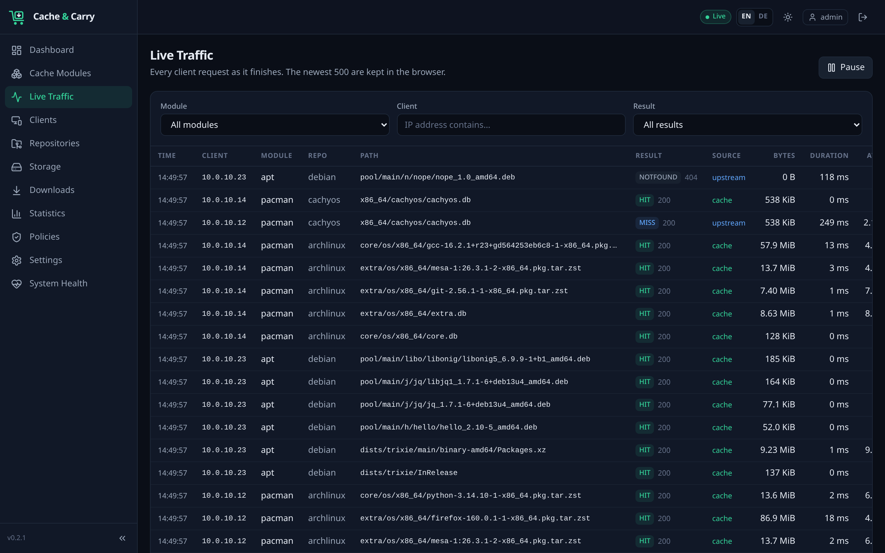
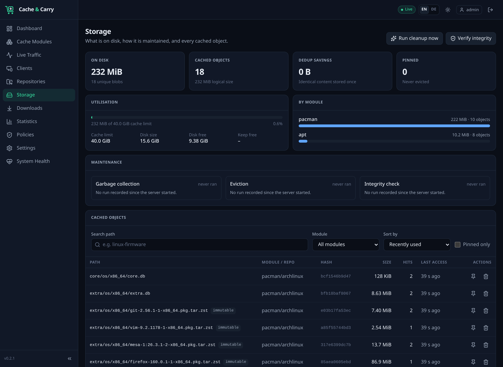
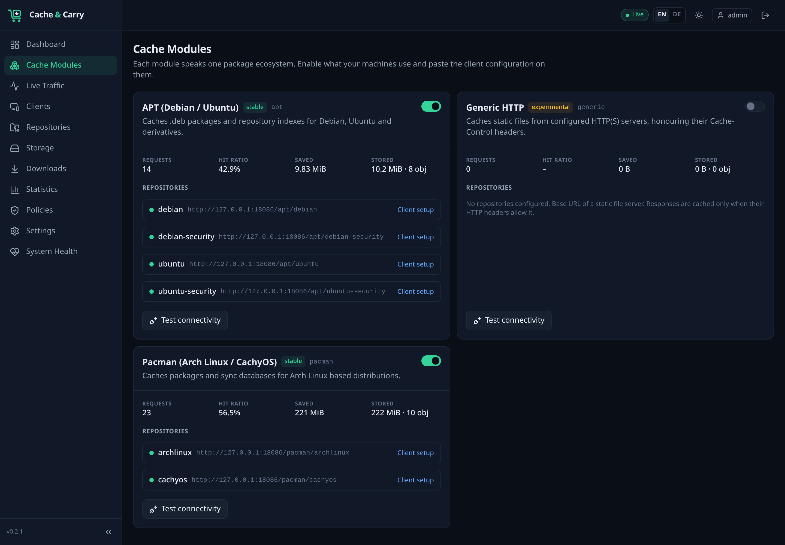
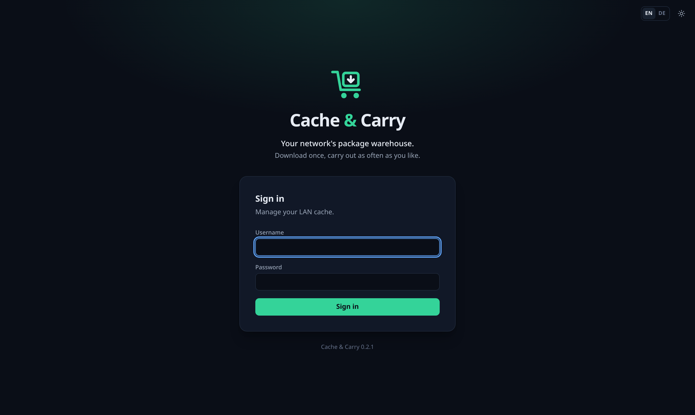
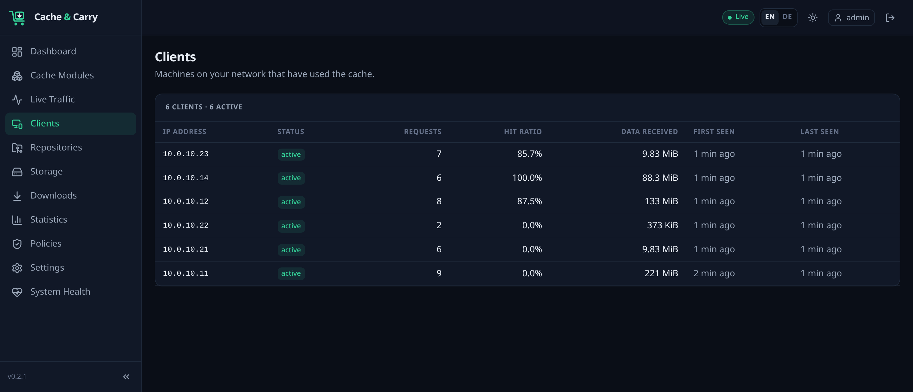
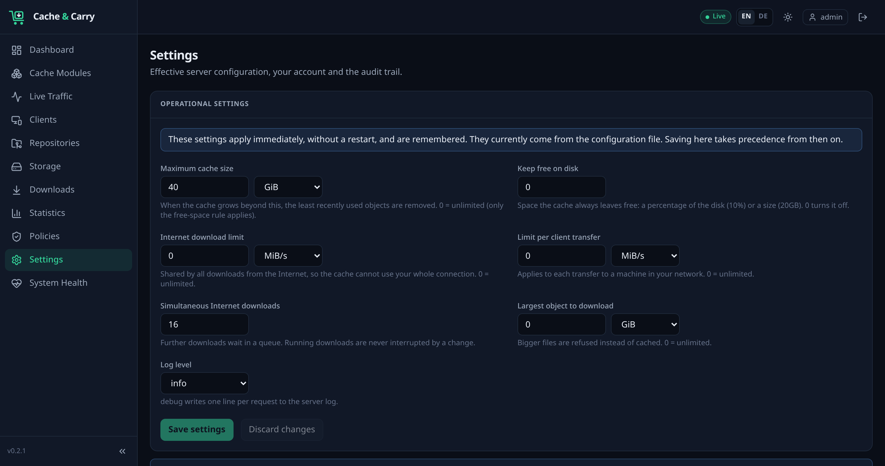
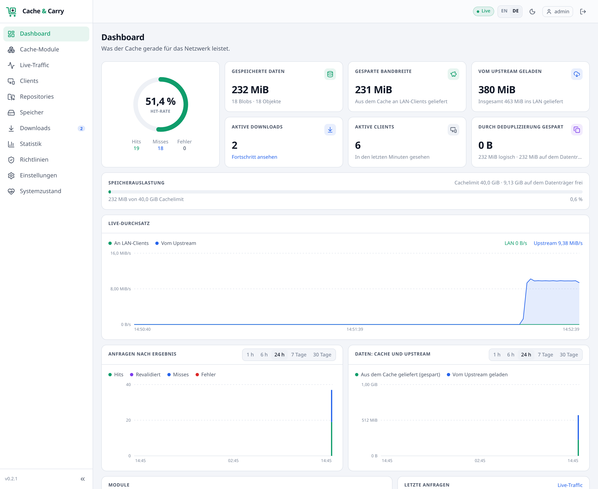

<p align="center">
  <picture>
    <source media="(prefers-color-scheme: dark)" srcset="assets/brand/logo-slogan-on-dark.png">
    
  </picture>
</p>

<p align="center">
  <a href="https://cachencarry.loopout.tech"><b>cachencarry.loopout.tech</b></a>
</p>

<p align="center">
  <a href="LICENSE"></a>
  
  <a href="https://github.com/Anarki-LNX/cachencarry/releases/latest"></a>
  <a href="https://github.com/Anarki-LNX/cachencarry/pkgs/container/cachencarry"></a>
  
</p>

**Cache & Carry is a small server for your home lab or office network that
keeps every package your machines download.** The first computer fetches an
update from the Internet. Every other computer gets it from the box next
door, at LAN speed.

One binary. One storage folder. One dashboard. No database server, no Java,
no Kubernetes.



## See it work

**Two machines ask for the same file at the same moment. Only one download
runs.** Both are fed from it while it is still arriving.



**Every request is visible as it happens.** `MISS` means it came from the
Internet, `HIT` means it came from your own disk.



**You always know what is stored and what it costs.** Pin what must stay,
remove what you do not need, verify the integrity of every file.



**Client setup is copy and paste.** The dashboard shows the exact lines for
each repository.



<details>
<summary>More screenshots: sign in, clients, settings, German and light mode</summary>






</details>

## Why you want this

| | |
|---|---|
| **Updates at LAN speed** | A package index of 8.6 MiB took 959 ms from the Internet and 9 ms from the cache in our test network. |
| **One download for everyone** | Ten clients asking for the same uncached file cause exactly one upstream download. Nobody waits for it to finish, all are streamed while it runs. |
| **Stored once, used everywhere** | Files are kept by their SHA-256 content hash. The same file from two repositories or two distributions takes space once. |
| **Arch and Debian under one roof** | Pacman and APT are served by the same engine, with the same storage limit and the same statistics. |
| **Nothing to trust blindly** | Signatures pass through byte for byte. `apt` and `pacman` verify packages against their own keyrings exactly as before. No TLS interception, no certificate to install on clients. |
| **Survives bad days** | Interrupted downloads resume. If a mirror is down, the next one is tried. If the Internet is down, everything already cached keeps installing. |
| **Honest numbers** | Saved bandwidth is measured from the bytes that really went over the wire, not estimated. |
| **Tiny** | About 13 MB of memory when idle, a 15 MB container image, a single static binary. |
| **Yours to tune** | Cache size, bandwidth limits and policies change in the dashboard and apply at once, without a restart. |
| **English and German** | Switch the language in the top right corner. |

## What it caches today

| Ecosystem | Status | Tested with real clients |
|---|---|---|
| **Pacman** (Arch Linux, CachyOS) | ready | Arch Linux, CachyOS |
| **APT** (Debian, Ubuntu, Proxmox, Docker's package repositories) | ready | Debian 12 and 13, Ubuntu 26.04, Proxmox VE 9.2 |
| **Plain HTTP file servers** | experimental | mock servers only |
| Container images (Docker, Podman), npm, PyPI, RPM, Maven | planned | |
| Game downloads and Windows updates | planned as integrations | |

This is an early release. [TODO.md](TODO.md) lists exactly what has been run
and verified and what has not. Nothing here is advertised that does not exist.

## Get started

Three ways to install. All three ship the same release with the same
version number: one tag builds the packages and the container image.

| Way | For | Command |
|---|---|---|
| [1. Proxmox VE](#1-proxmox-ve-with-one-command) | a ready LXC container on your Proxmox host | one line on the host |
| [2. Debian or Ubuntu](#2-debian-or-ubuntu-with-the-release-package) | any Debian or Ubuntu machine, VM or container | download, `install.sh` |
| [3. Docker](#3-docker) | any Docker host | `docker run` or `docker compose up` |

### 1. Proxmox VE with one command

Run this on the Proxmox VE host as root. It creates an unprivileged Debian 13
container without nesting, installs the latest release for amd64 or arm64
after checking it against `SHA256SUMS`, and prints the address and the setup
token:

```sh
bash -c "$(curl -fsSL https://raw.githubusercontent.com/Anarki-LNX/cachencarry/main/scripts/proxmox-lxc.sh)"
```

Container ID, storage, cache size and a static address can be set with
variables such as `CC_CTID=130 CC_CACHE_GB=200 CC_IP=192.168.1.20/24 CC_GW=192.168.1.1`.
Updating later is the same command followed by `-- update <container ID>`.
Details: [DEPLOYMENT.md](DEPLOYMENT.md#proxmox-lxc).

### 2. Debian or Ubuntu with the release package

Download the package for your machine from the
[latest release](https://github.com/Anarki-LNX/cachencarry/releases/latest)
(`amd64` for normal PCs and servers, `arm64` for a Raspberry Pi and similar)
and install it:

```sh
tar xzf cachencarry-*-linux-amd64.tar.gz
cd cachencarry-*-linux-amd64
sudo ./scripts/install.sh
```

The package contains one static binary, the systemd service, an example
configuration and the install script. Nothing else is needed on the target.
To build it yourself instead, run `make dist` on a machine with Go 1.27 and
Node.js 20 or newer.

Open `http://<address>:8080` and create your account. The setup asks for a
one-time token that proves you have access to the server:

```sh
su -s /bin/sh cachencarry -c '/usr/local/bin/cachencarry setup-token'
```

An unprivileged Proxmox LXC container with 2 cores and 1 GB of memory is
plenty. The full guide, including upgrades and backups, is in
[DEPLOYMENT.md](DEPLOYMENT.md).

### 3. Docker

The image `ghcr.io/anarki-lnx/cachencarry` is published for amd64 and arm64
with every release.

```sh
docker run -d --name cachencarry --restart unless-stopped -p 8080:8080 \
  -v cachencarry-data:/var/lib/cachencarry \
  -e CACHENCARRY_SECURITY_ADMIN_PASSWORD=choose-a-long-password \
  ghcr.io/anarki-lnx/cachencarry:latest
```

With Docker Compose and the hardening options of the shipped compose file:

```sh
git clone https://github.com/Anarki-LNX/cachencarry.git
cd cachencarry
cp .env.example .env      # set CACHENCARRY_ADMIN_PASSWORD, at least 10 characters
docker compose pull
docker compose up -d
```

`docker compose up -d --build` builds the image from source instead.

### Point a machine at it

Arch Linux, first line of `/etc/pacman.d/mirrorlist`:

```ini
Server = http://<address>:8080/pacman/archlinux/$repo/os/$arch
```

Debian 13, `/etc/apt/sources.list.d/debian.sources`:

```
Types: deb
URIs: http://<address>:8080/apt/debian
Suites: trixie trixie-updates
Components: main contrib non-free-firmware
Signed-By: /usr/share/keyrings/debian-archive-keyring.gpg
```

CachyOS, Ubuntu, Proxmox and others are covered in
[docs/CLIENTS.md](docs/CLIENTS.md).

## How it works

Every file is downloaded once into a temporary file and hashed with SHA-256
while it streams to the waiting clients. When it is complete it is flushed to
disk and moved to its final place in one atomic step, so a half finished
download can never be served as a valid file. A small SQLite database
remembers which repository path points to which file.

Packages never change under the same name, so they are served from disk
without asking anyone. Package lists do change, so they are checked with the
mirror after a few minutes and only fetched again when they are new.

Read more in [ARCHITECTURE.md](ARCHITECTURE.md).

## What it is not

- **Not an artifact repository.** You cannot publish or host your own packages. Nexus, Artifactory and Pulp do that.
- **Not a transparent proxy.** It only talks to mirrors you configured, and clients are pointed at it on purpose.
- **Not a security scanner.** It does not judge packages. Your package manager's signature check stays the authority.

[COMPETITIVE_ANALYSIS.md](COMPETITIVE_ANALYSIS.md) compares it with
apt-cacher-ng, pacoloco, Nexus, Pulp, Harbor and LanCache.

## Documentation

| Document | Content |
|---|---|
| [DEPLOYMENT.md](DEPLOYMENT.md) | Proxmox LXC, systemd, Docker, upgrades, backup |
| [docs/CLIENTS.md](docs/CLIENTS.md) | Client configuration for every supported system |
| [ADAPTERS.md](ADAPTERS.md) | What each module caches and how to write a new one |
| [ARCHITECTURE.md](ARCHITECTURE.md) | Storage engine, download manager, concurrency |
| [SECURITY.md](SECURITY.md) | Threat model, defaults, how to report a problem |
| [docs/API.md](docs/API.md) | Management API |
| [docs/TROUBLESHOOTING.md](docs/TROUBLESHOOTING.md) | Common problems and their fixes |
| [ROADMAP.md](ROADMAP.md) and [TODO.md](TODO.md) | What comes next and what is not verified yet |
| [CONTRIBUTING.md](CONTRIBUTING.md) | Development setup and rules |
| [assets/brand](assets/brand) | Logo and brand files |
| [website/](website) | Source of the project website [cachencarry.loopout.tech](https://cachencarry.loopout.tech) |

## Build and test

```sh
make test     # unit and end-to-end tests against local mock mirrors, no Internet needed
make race     # the same with the race detector
make build    # dashboard plus a single static binary in bin/cachencarry
make docker   # container image
```

## Support the project

Cache & Carry is free and open source. If it saves you time and bandwidth and
you want to support its development, a voluntary donation is welcome:
[paypal.me/HenryMeinekat](https://www.paypal.me/HenryMeinekat). Stars,
bug reports and pull requests help just as much.

## License

[Apache License 2.0](LICENSE). Third-party components are listed in
[NOTICE.md](NOTICE.md).
